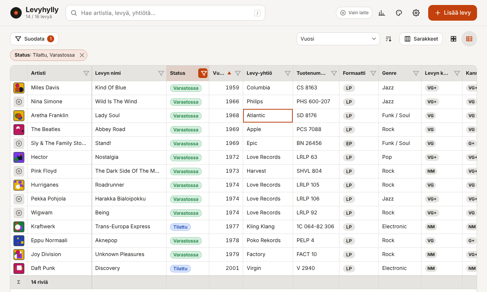
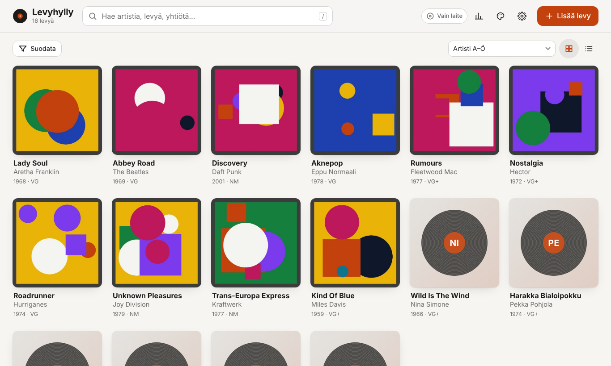
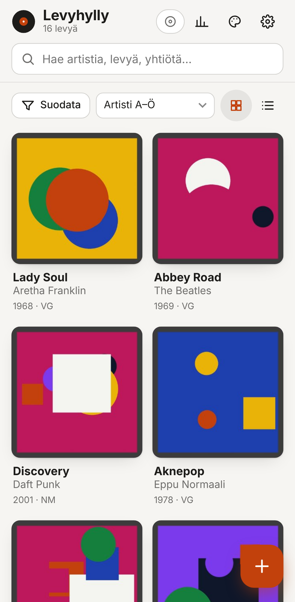

# Levyhylly – LP-kokoelman hallinta

**Sovellus:** https://sarpatch.github.io/album-catalog/

Selaimessa toimiva, asennettava sovellus (PWA) LP-levykokoelman hallintaan. Toimii kännykällä ja läppärillä, myös ilman verkkoyhteyttä. Tietolähteenä on **CSV-tiedosto**, ja kansikuvat ovat tavallisia JPEG-tiedostoja. Tiedot voi pitää laitteella, omassa kansiossa, **Dropboxissa** tai **Google Drivessa**, ja tallennuspaikkaa voi vaihtaa milloin tahansa.



| Kansinäkymä läppärillä | Kännykkä |
|---|---|
|  |  |

## Ominaisuudet

- **Taulukko kuten Excelissä.** Jokaisen sarakkeen voi lajitella ja suodattaa otsikosta. Arvoja voi muokata suoraan solussa näppäimistöllä tai kosketuksella. Kopioi ja liitä toimivat myös Excelistä kopioiduilla alueilla, ja Ctrl+Z kumoaa muutoksen. Sarakkeiden leveyttä ja näkyvyyttä voi säätää, ja summarivi laskee rahasummat yhteen.
- **Omat kentät ilman uutta versiota.** Kentät määritellään tiedostossa [`kentat.json`](kentat.json): nimi, tyyppi, valintalistan vaihtoehdot, pakollisuus ja oletusarvo. Kenttiä voi muokata sovelluksen kenttäeditorissa tai suoraan tiedostosta Dropboxissa tai Drivessa. Muutos tulee käyttöön lomakkeelle, taulukkoon, suodattimiin, tilastoihin ja CSV:hen ilman koodimuutoksia.
- **Status ja kauppa.** Oletuskentissä on status (Tilattu / Varastossa / Myyty, värikoodattu), osto- ja myyntipäivä sekä osto- ja myyntihinta.
- **Kansikuvat kameralla tai galleriasta.** Kuvan voi rajata neliöksi (vetämällä, nipistämällä tai liukusäätimellä) ja kiertää. Kuvat pienennetään automaattisesti, ja EXIF-suunta korjataan. Läppärillä kuvan voi myös raahata lomakkeeseen tai liittää leikepöydältä.
- **Haku, suodatus ja järjestäminen.** Haku toimii kaikista kentistä. Minkä tahansa kentän mukaan voi suodattaa joko arvolistalla, välillä (luvut, hinnat, päivämäärät) tai tekstihaulla, ja aktiiviset suodattimet näkyvät siruina. Järjestäminen toimii minkä tahansa kentän mukaan, myös usealla tasolla, ja artistin mukaan järjestettäessä The-sana ohitetaan. Näkymänä on kansiruudukko tai taulukko.
- **Alan käytännöt.** Kunto arvioidaan [Goldmine-asteikolla](https://www.goldminemag.com/collector-resources/record-grading-101) (M, NM, VG+ … P) erikseen levylle ja kannelle. Kentät ovat Discogs-yhteensopivat: tuotenumero, levy-yhtiö, maa, tyyli ja release ID.
- **Tuonti ja vienti.** Tuetut muodot ovat CSV (pilkku tai puolipiste), Excel-yhteensopiva CSV, oma ZIP-varmuuskopio (CSV + kentät + kuvat) ja **Discogsin kokoelmavienti**. Vientiin voi valita myös pelkän nykyisen suodatetun näkymän. Tuonnissa tunnistetaan suomen- ja englanninkieliset sarakenimet, ja tuntemattomista sarakkeista voi tehdä uusia kenttiä. Tuplat huomataan sekä tuonnissa että lisättäessä.
- **Synkronointi.** Sama kokoelma toimii kännykällä ja läppärillä. Muutokset yhdistetään kolmisuuntaisesti, joten myös poistot välittyvät oikein. Käsin (esim. Excelissä) muokattu CSV huomataan, ja tunnisteeton uusi rivi saa automaattisesti id:n.
- **Vaihdettavat teemat.** Valmiina on seitsemän teemaa, automaattinen vaalea/tumma sekä oma teema värivalitsimilla. Uuden teeman voi lisätä muutamalla rivillä.
- **Turvallisuus ja luotettavuus.**
  - Kansikuvat tallentuvat laitteen IndexedDB-muistiin, ja sovellus pyytää selainta säilyttämään tiedot pysyvästi.
  - Poiston voi perua.
  - Jos kokoelmasta ei ole varmuuskopiota, sovellus muistuttaa sen ottamisesta.
  - CSV-viennissä on suojaus kaavainjektiota vastaan.
  - Sivulla on tiukka Content Security Policy, eikä se käytä ulkoisia kirjastoja.
  - Pilvipalveluihin annetaan vain suppeimmat oikeudet (Dropbox: oma sovelluskansio, Google: `drive.file`).
- **Saavutettavuus.** Sovellusta voi käyttää kokonaan näppäimistöllä (ks. [Taulukon näppäimet](#taulukon-näppäimet)). Kosketusalueet ovat vähintään 44 px, ja `prefers-reduced-motion` huomioidaan. Androidin takaisin-painike sulkee auki olevan ikkunan.

## Käyttöönotto

Sovellus on pelkkiä staattisia tiedostoja, eikä se vaadi käännösvaihetta tai palvelinta.

### 1. Julkaisu GitHub Pagesiin

1. Puske repo GitHubiin.
2. Valitse **Settings → Pages → Build and deployment → Source: GitHub Actions**.
3. Mukana oleva työnkulku (`.github/workflows/pages.yml`) ajaa testit ja julkaisee sovelluksen osoitteeseen https://sarpatch.github.io/album-catalog/.
4. Avaa osoite kännykällä ja valitse selaimen valikosta **Lisää aloitusnäyttöön** (Android: *Asenna sovellus*). Läppärin Chromessa asennuspainike on osoiterivillä.

Paikallinen kokeilu: `npm start` (tai `python3 -m http.server 8080`) ja selaimella `http://localhost:8080`.

### 2. Dropbox (valinnainen)

1. Avaa [dropbox.com/developers/apps](https://www.dropbox.com/developers/apps) → **Create app**.
2. Valitse *Scoped access* → **App folder**. Anna nimi, esim. `Levyhylly`.
3. Lisää **Permissions**-välilehdellä oikeudet `files.content.write` ja `files.content.read` ja paina *Submit*.
4. Lisää **Settings**-välilehdellä kohtaan *OAuth 2 → Redirect URIs* sovelluksen osoite tarkalleen, `https://sarpatch.github.io/album-catalog/`. Lisää kehitystä varten myös `http://localhost:8080/`.
5. Kopioi **App key**. Liitä se joko sovelluksen *Asetukset → Pilvipalveluiden avaimet* -kohtaan tai pysyvästi tiedostoon `js/config.js`, jolloin sitä ei tarvitse syöttää joka laitteella.
6. Valitse *Asetukset → Tallennuspaikka → Dropbox* ja kirjaudu.

Tiedostot tulevat Dropboxiin kansioon *Sovellukset / Levyhylly / LP-kokoelma*.

### 3. Google Drive (valinnainen)

1. Luo projekti [Google Cloud Consolessa](https://console.cloud.google.com/).
2. Valitse **APIs & Services → Library** ja ota käyttöön **Google Drive API**.
3. Valitse **OAuth consent screen**: *External*, täytä nimi ja sähköposti. Lisää scope `.../auth/drive.file` ja lisää itsesi kohtaan *Test users*.
4. Valitse **Credentials → Create credentials → OAuth client ID → Web application**. Lisää kohtaan *Authorized JavaScript origins* sovelluksen alkuperä, `https://sarpatch.github.io`, sekä `http://localhost:8080`.
5. Kopioi **Client ID** (`…apps.googleusercontent.com`) asetuksiin tai tiedostoon `js/config.js`.
6. Valitse *Asetukset → Tallennuspaikka → Google Drive*.

Tiedostot tulevat Driven juureen kansioon *LP-kokoelma*.

> `drive.file`-oikeuden vuoksi sovellus näkee vain itse luomansa tiedostot. Jos lisäät kuvia kansioon Driven kautta käsin, sovellus ei näe niitä. Lisää kuvat sovelluksen kautta. Googlen istunto kestää tunnin, minkä jälkeen yläpalkkiin tulee *Kirjaudu*-painike.

### 4. Kansio tietokoneella (Chrome/Edge)

Läppärillä voit valita tallennuspaikaksi minkä tahansa kansion. Se voi olla myös Dropboxin, OneDriven tai Google Driven työpöytäsovelluksen synkronoima kansio. Tällöin pilviavaimia ei tarvita lainkaan.

### Tallennuspaikan vaihtaminen

Valitse *Asetukset → Tallennuspaikka* ja napauta uutta paikkaa. Laitteella oleva kokoelma, kenttämäärittely ja kansikuvat kopioidaan uuteen paikkaan. Jos siellä on jo kokoelma (esim. toiselta laitteelta), kokoelmat yhdistetään. Laite pitää aina oman työkopionsa, joten sovellus toimii myös verkotta ja synkronoi, kun yhteys palaa.

## Taulukon näppäimet

| Näppäin | Toiminto |
|---|---|
| Nuolet, Tab, Home/End, PgUp/PgDn | Liiku soluissa (Ctrl + nuoli: reunaan) |
| Enter, F2 tai tuplaklikkaus | Muokkaa solua (kännykällä napautus) |
| Kirjoittaminen | Korvaa solun arvon |
| Enter / Tab muokatessa | Hyväksy ja siirry alas / oikealle |
| Esc | Peru muokkaus |
| Delete | Tyhjennä solu |
| Välilyönti | Vaihda kyllä/ei-kentän arvo |
| Ctrl+C / Ctrl+V | Kopioi solu / liitä (myös Excelistä kopioitu alue) |
| Ctrl+Z | Kumoa viimeisin muutos |
| Ctrl+Enter | Avaa levyn tiedot |
| Otsikon napsautus / Shift+napsautus | Lajittele / lisää toissijainen lajittelu |
| `/` ja `n` (taulukon ulkopuolella) | Hakuun / uusi levy |

Kun solua muokataan, rivien järjestys pysyy paikallaan kuten Excelissä. Työkalurivin **Päivitä järjestys ja suodatus** -painike järjestää ja suodattaa rivit uudelleen.

## Kentät (`kentat.json`)

Kentät määritellään JSON-tiedostossa, jota sovellus lukee käynnistyessään ja jokaisen synkronoinnin yhteydessä. **Uuden kentän lisääminen ei vaadi uutta sovellusversiota.** Kentän voi lisätä kolmella tavalla:

1. **Sovelluksessa:** *Asetukset → Kentät → Muokkaa kenttiä*. Täällä kenttiä voi lisätä, nimetä uudelleen, järjestää, piilottaa ja poistaa sekä muuttaa niiden tyyppiä ja vaihtoehtoja.
2. **Tiedostosta pilvessä:** kun tallennuspaikkana on Dropbox, Google Drive tai kansio, `kentat.json` on samassa kansiossa kuin `kokoelma.csv`. Muokkaa sitä millä tahansa tekstieditorilla, niin muutos näkyy kaikilla laitteilla seuraavassa synkronoinnissa.
3. **Julkaisun oletukset:** repon juuressa oleva [`kentat.json`](kentat.json) on oletus niille, jotka eivät ole muokanneet kenttiä. Palvelu lukee tiedoston aina verkosta, joten muutos näkyy heti ilman välimuistin tyhjennystä.

Esimerkki: lisätään tähtiarvio ja valintalista painokselle.

```json
{ "key": "arvio", "label": "Oma arvio", "type": "rating", "group": "Omat" },
{ "key": "painos", "label": "Painos", "type": "select", "group": "Julkaisu",
  "options": ["1. painos", "Uusintapainos", "Bootleg"], "colors": { "1. painos": "#b45309" } }
```

| Ominaisuus | Merkitys |
|---|---|
| `key` | Sarakkeen nimi CSV:ssä (pienet kirjaimet, numerot, `_`). **Älä muuta jälkikäteen**, koska tiedot kytkeytyvät tähän nimeen. |
| `label` | Näkyvä nimi; vapaasti muutettavissa |
| `type` | `text`, `textarea`, `number`, `money`, `date`, `select`, `grade` (Goldmine), `checkbox`, `rating` (1–5), `url` |
| `group` | Lomakkeen osio, johon kenttä kuuluu |
| `options`, `colors` | Valintalistan vaihtoehdot ja niiden värit |
| `required`, `default` | Pakollinen kenttä ja uuden levyn oletusarvo |
| `min`, `max`, `decimals` | Lukujen rajat ja desimaalit |
| `table: false` | Sarake on oletuksena piilossa taulukossa (käyttäjä voi näyttää sen) |
| `hidden: true` | Kenttä piilotetaan kokonaan, mutta sen tiedot säilyvät |
| `sum: true` | Lukukenttä lasketaan yhteen summarivillä (rahasummat aina) |
| `width` | Sarakkeen oletusleveys pikseleinä |
| `aliases` | Sarakenimet, jotka tuonnissa tunnistetaan tähän kenttään |

Virheellinen määrittely ei kaada sovellusta. Viallinen kenttä ohitetaan tai korjataan, ja huomautus näkyy asetuksissa. Jos tiedosto ei ole kelvollista JSONia, sovellus käyttää edellistä toimivaa määrittelyä eikä ylikirjoita tiedostoa, joten virheen voi korjata rauhassa. Poistetun kentän arvot säilyvät CSV:ssä ja palaavat näkyviin, jos kenttä lisätään uudelleen samalla `key`-nimellä.

## Tiedostomuoto

```
LP-kokoelma/
├── kokoelma.csv          ← tietolähde (UTF-8, pilkkuerotin, RFC 4180)
├── kentat.json           ← kenttämäärittely
└── kannet/
    └── <id>-<tunniste>.jpg  (1000 × 1000 px)
```

| Sarake | Sisältö |
|---|---|
| `id` | UUID, pysyvä tunniste. Tyhjä = uusi rivi, sovellus luo tunnisteen. |
| *kentät* | Yksi sarake jokaista `kentat.json`-kenttää kohden määrittelyn järjestyksessä. Oletuksena: `artist`, `title`, `status`, `year`, `label`, `catalog_number`, `country`, `format`, `size`, `speed_rpm`, `discs`, `genre`, `style`, `media_grade`, `sleeve_grade`, `location`, `purchase_date`, `purchase_price`, `purchase_place`, `sale_date`, `sale_price`, `barcode`, `discogs_id`, `notes` |
| *muut* | Sarakkeet, joita määrittelyssä ei ole (esim. poistetut kentät), säilyvät sellaisinaan |
| `cover_file` | Suhteellinen polku kansikuvaan |
| `created_at`, `updated_at` | ISO 8601 -aikaleimat. Synkronointi käyttää näitä. |

Arvojen tallennusmuoto: päivämäärät `vvvv-kk-pp`, rahasummat pisteellä (`12.50`), kyllä/ei-kenttä `kyllä` tai tyhjä ja tähtiarvio `1`–`5`. Käsin kirjoitetut muodot, kuten `24.12.2021` ja `12,50 €`, muunnetaan automaattisesti, kun arvoa muokataan sovelluksessa.

CSV:tä voi muokata myös Excelissä tai Google Sheetsissä. Muokattu rivi tunnistetaan seuraavassa synkronoinnissa. Tunnisteettomat uudet rivit saavat automaattisesti id:n ja kenttien oletusarvot. Mallitiedosto on [`examples/esimerkkikokoelma.csv`](examples/esimerkkikokoelma.csv).

## Teemat

Teeman voi vaihtaa yläpalkin paletti-ikonista tai *Asetuksista*. *Oma teema* tehdään värivalitsimilla suoraan sovelluksessa. Pysyvän uuden teeman saa lisäämällä olion tiedoston [`js/themes.js`](js/themes.js) listaan `THEMES`:

```js
{
  id: 'sinappi', name: 'Sinappi', scheme: 'light',
  colors: { bg: '#fdf6e3', text: '#2d2a24', accent: '#b58900' },
  font: 'serif',   // sans | serif | rounded | condensed | mono
  radius: '10px',
},
```

Pakollisia ovat vain tausta-, teksti- ja korostusväri. Pinnat, reunat ja himmeät tekstit lasketaan niistä automaattisesti, ja korostusvärin päälle valitaan luettava tekstiväri.

## Kehitys

```
index.html            sovelluksen runko
css/app.css           tyylit (mobiili ensin, läppäri ≥ 760 px)
kentat.json           oletuskentät (luetaan ajonaikaisesti)
js/app.js             näkymät ja toiminnot
js/schema.js          kenttätyypit: siistiminen, validointi, muotoilu, vertailu
js/model.js           levyt, tuonnin sarakevastaavuudet, tilastot
js/query.js           suodatus ja lajittelu minkä tahansa kentän mukaan
js/table.js           Excel-tyyppinen taulukko (virtualisoitu, muokattava)
js/filters.js         suodatinvalikko
js/fieldeditor.js     kenttäeditori
js/csv.js             RFC 4180 -jäsennin/kirjoitin
js/merge.js           kolmisuuntainen yhdistäminen
js/sync.js            synkronointi tallennuspaikan kanssa
js/backends/*.js      Dropbox, Google Drive, kansio – yhteinen rajapinta
js/db.js              IndexedDB
js/image.js, cropper.js  kuvankäsittely ja rajaus
js/themes.js          teemat
js/zip.js             ZIP-luku/kirjoitus ilman kirjastoja
sw.js                 offline-välimuisti
tests/                yksikkö- ja synkronointitestit (node --test)
```

```bash
npm test     # Node 20+
npm start    # http://localhost:8080
```

Uuden tallennuspaikan lisääminen tehdään toteuttamalla `js/backends/index.js`:n kuvaama rajapinta (`connect`, `read`, `write`, `remove`, `describe`) ja lisäämällä se listaan `BACKENDS`.

Julkaistessa nosta `VERSION`-arvoa tiedostossa `sw.js`, niin asennetut sovellukset tarjoavat päivitystä.

## Lisenssi

MIT
